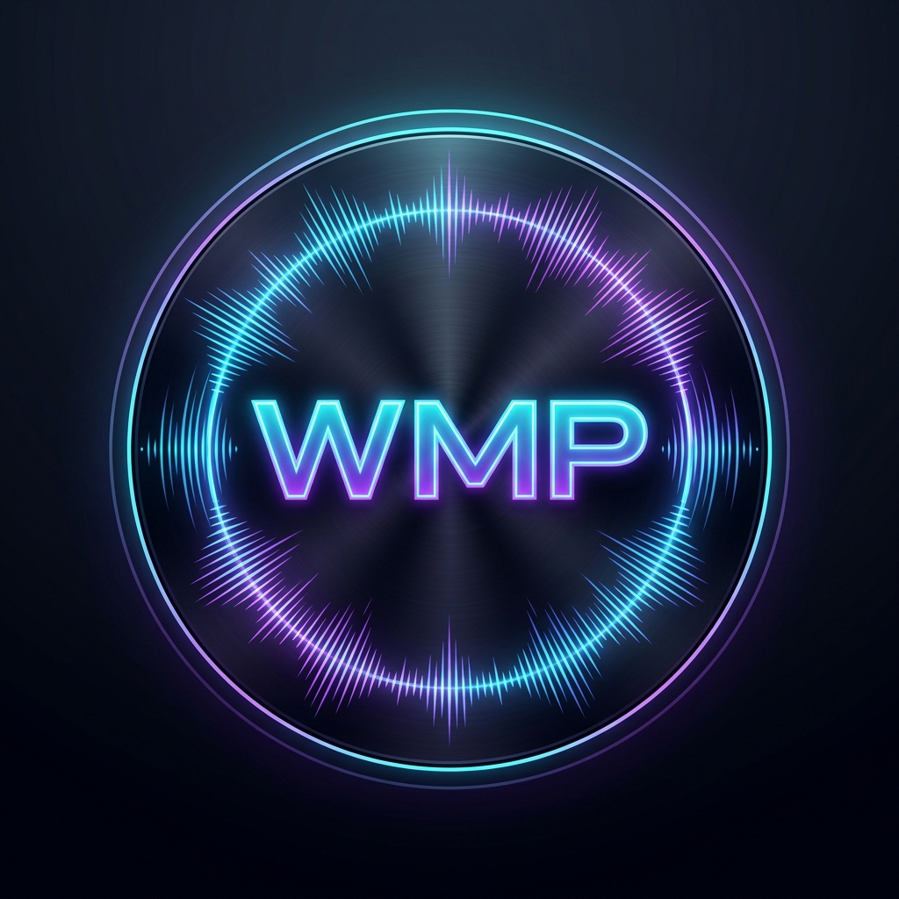

<p align="center">
  
</p>

<h1 align="center">Wild Music Player</h1>

<p align="center">
  A music player for Android that plays the songs on your phone and lets you mix in songs from YouTube.
  Built for everyday listening and for the car.
</p>

<p align="center">
  <a href="https://github.com/Petya122/wild_music_player/releases/latest"></a>
  <a href="LICENSE"></a>
  
</p>

---

## Features

- **Your music library**: songs, albums, artists, folders, Most Played and Recently Added. Edit song
  details and fix tags.
- **Playlists**: mix the songs on your phone with YouTube songs. Reorder, undo, back up and restore,
  and export as M3U8.
- **YouTube search, streaming and downloads**: search with best-match picking, a download queue that
  continues where it stopped, and cover art plus artist and title on downloaded songs.
- **Offline mode**: one switch stops streaming and downloads. Downloaded copies are played instead.
- **Synced lyrics** from LRCLIB or your own lyrics files, with a timing fix bar.
- **Sound**: equalizer, real loudness normalization, decibel boost, crossfade, sound profiles per
  device (including the car), and a sleep timer.
- **Home screen and system**: player widgets, a playlist widget, a Quick Settings tile, app icon
  shortcuts, and favorite, shuffle and repeat from the notification.
- **In the car**: song titles and RPT over Bluetooth, resume when the car reconnects, and
  **Android Auto** with browsing, search, queue and voice.
- **Themes**, a cover-colored player, listening stats, and in-app updates from this repository.

## Install

1. Download `wild_music_player-vX.Y.Z.apk` from the
   [latest release](https://github.com/Petya122/wild_music_player/releases/latest).
2. Open it on your phone, and allow **Install unknown apps** for your browser or file manager when
   Android asks.
3. Later updates come through the app: **Settings → Updates & Version**.

Requires Android 8.0 (API 26) or newer.

**Checking the APK.** Every release is built by GitHub Actions from the tag of the same name and
signed with the app's release key. The in-app updater refuses any file that isn't signed with this key.
You can check a downloaded APK yourself:

```bash
apksigner verify --print-certs wild_music_player-vX.Y.Z.apk
```

The SHA-256 certificate digest must be:

```
cdbdda1748b6d2a9ee278a754965f490894529614b7d64b3d0b09baa93908c20
```

**Android Auto.** Apps installed from outside the Play Store only show up in Android Auto after you
turn on **Unknown sources** in Android Auto's developer settings. To unlock those settings, tap the
version number in Android Auto's settings 10 times.

## Permissions

| Permission | Why |
|---|---|
| Music and audio (`READ_MEDIA_AUDIO`, storage on older Android) | To find and play the songs on your phone |
| Notifications | The player controls and download progress |
| Foreground service (media playback, data sync) | Keeps the music playing and downloads running when the app is in the background |
| Internet, network state | YouTube, lyrics and updates, and noticing when you go offline |
| Install packages | Installs updates you downloaded from this repository |
| Wake lock, audio settings | No gaps when the screen is off, and the equalizer and loudness features |

## Privacy

Wild Music Player has **no accounts, ads, analytics or tracking**. Your library, playlists, play counts
and settings stay on your phone.

The app connects to these services, and only for these reasons:

| Service | When | What is sent |
|---|---|---|
| **YouTube** (through [NewPipeExtractor](https://github.com/TeamNewPipe/NewPipeExtractor)) | You search, stream or download | Your search words and the video you picked |
| **[LRCLIB](https://lrclib.net)** | A song's lyrics are shown for the first time | The song's title, artist, album and length. The app identifies itself with its name, version and this repository's link |
| **GitHub** | You tap **Check for updates**, or download an update | The usual request for this repository's releases |
| Image hosts (YouTube / Google) | Covers of YouTube songs are shown | The cover's address |

Every service sees your IP address, as on any website. **Offline mode** stops streaming, downloads and
new lyrics lookups. Lyrics that were already found keep working.

Android's own backup (if you turn it on) can save the app's playlists and settings to your Google
account. It's handled by Android, not by this app.

## Legal

- **Not affiliated.** Wild Music Player is an independent project. It isn't affiliated with,
  sponsored by or endorsed by Google, YouTube, YouTube Music, Android, Android Auto, LRCLIB or
  NewPipe. These names and logos belong to their owners and are used here only to say what the app
  works with.
- **Content belongs to its owners.** Songs, videos, covers and lyrics found online belong to their
  rights holders. When you stream or download, you are responsible for following
  [YouTube's Terms of Service](https://www.youtube.com/t/terms) and the copyright law where you live.
  Only download what you're allowed to: your own uploads, Creative Commons or public-domain music, or
  where your country's law allows a private copy.
- **Lyrics** come from [LRCLIB](https://lrclib.net) and belong to their authors. The app only shows
  them and saves a copy on your phone for offline use. This repository contains no lyrics.
- **No warranty.** This app is free software, provided "as is", without any warranty. Use it at your
  own risk. The exact terms are in sections 15 and 16 of the [license](LICENSE).

## Building from source

You need JDK 17 and the Android SDK (Android Studio installs both).

```bash
./gradlew :app:assembleDebug
```

```bash
./gradlew :shared:testAndroid testDebugUnitTest
```

The debug APK lands in `app/build/outputs/apk/debug/`. A debug build has a different signature, so it
can't update a copy installed from the releases: uninstall that copy first.

Release builds need your own signing key. Copy `keystore.properties.template` to
`keystore.properties` and fill it in. The real release key and its password are never in this
repository.

**Source for every release.** Each APK on the
[releases page](https://github.com/Petya122/wild_music_player/releases) is built from the git tag
with the same name. For example, the source for `v0.9.7` is
[tag v0.9.7](https://github.com/Petya122/wild_music_player/tree/v0.9.7).

## Third-party software

The APK includes these libraries. Their licenses are also shown in the app: **About → Open source
licenses**.

| Library | License |
|---|---|
| [NewPipeExtractor](https://github.com/TeamNewPipe/NewPipeExtractor) | GPL-3.0-or-later |
| [nanojson](https://github.com/TeamNewPipe/nanojson) (NewPipe's copy) | Apache-2.0 (also offered under MIT) |
| [Mozilla Rhino](https://github.com/mozilla/rhino) | MPL-2.0 (a few parts under other permissive licenses, see its license) |
| [jsoup](https://jsoup.org) | MIT |
| [Protocol Buffers (Java lite)](https://github.com/protocolbuffers/protobuf) | BSD-3-Clause |
| [AndroidX](https://developer.android.com/jetpack/androidx): Core, Activity, Lifecycle, Media3 (ExoPlayer and session), Compose, WorkManager, Palette | Apache-2.0 |
| [Compose Multiplatform](https://github.com/JetBrains/compose-multiplatform), [Kotlin](https://kotlinlang.org) and kotlinx (coroutines, serialization) | Apache-2.0 |
| [Material Icons](https://fonts.google.com/icons) | Apache-2.0 |
| [Coil](https://github.com/coil-kt/coil) | Apache-2.0 |
| [OkHttp](https://github.com/square/okhttp) and [Okio](https://github.com/square/okio) | Apache-2.0 |
| [Reorderable](https://github.com/Calvin-LL/Reorderable) | Apache-2.0 |
| [Accompanist Drawable Painter](https://github.com/google/accompanist) | Apache-2.0 |
| [Guava](https://github.com/google/guava), JSR-305 annotations, JetBrains annotations, JSpecify | Apache-2.0 |

All of them are compatible with the GPL-3.0.

## Security

Found a security problem? Please report it privately, as described in [SECURITY.md](SECURITY.md).

## License

Copyright © 2026 Petya122

Wild Music Player is free software: you can redistribute it and/or modify it under the terms of the
**GNU General Public License, version 3 only**, as published by the Free Software Foundation.

This program is distributed in the hope that it will be useful, but WITHOUT ANY WARRANTY; without even
the implied warranty of MERCHANTABILITY or FITNESS FOR A PARTICULAR PURPOSE. See the
[GNU General Public License](LICENSE) for more details.

The app logo and icons were made with AI image tools. They're covered by the same license, as far as
any rights in them exist.
